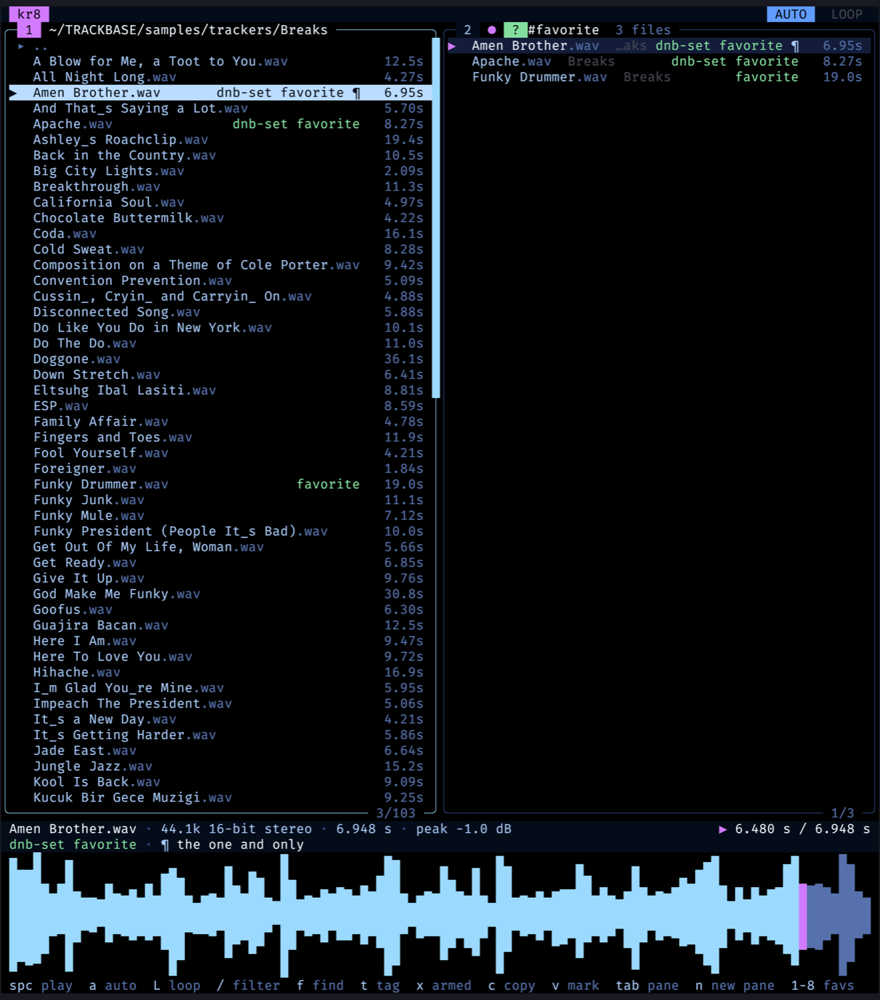
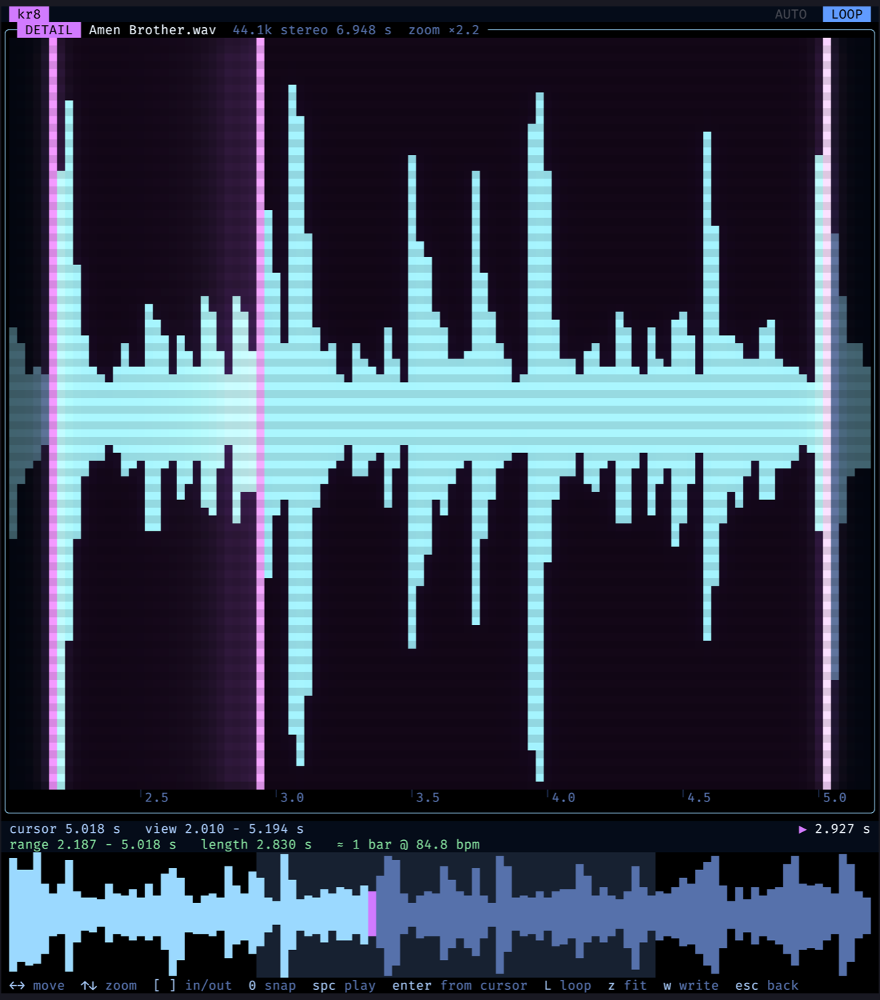
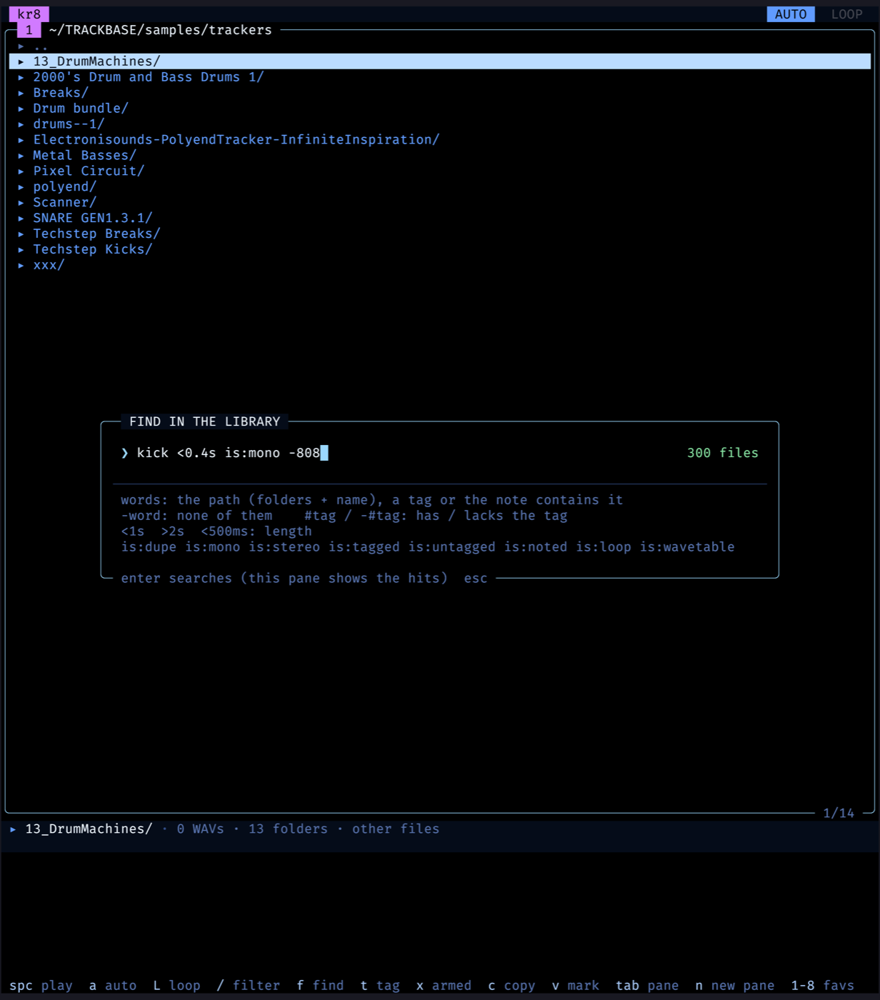

# kr8

**A keyboard-driven sample browser for the terminal** — browse, audition, tag, find and chop the WAVs
for your tracker sets (M8, LSDj, Polyend, DUET, …). Written in Zig on the
[movy](https://github.com/M64GitHub/movy) terminal engine. *kr8* as in "crate": crate digging, with a
nod to the M8.

<p align="center">
  
  
</p>

## What it does

- **Panes, Norton Commander style.** One to four folder panes, tiled automatically (side by side; left
  + right split; 2×2), `z` zooms one. Natural sort (`SC (97)` before `SC (101)`), a `/` word filter,
  eight favorite folders on `1`–`8`, a new folder on `M` / `F7`.
- **One key to listen.** `space` plays, `enter` replays from the start. **AUTO** plays whatever the
  cursor lands on — hold `j` through a folder of loops — and stops when it leaves. **LOOP** loops the
  preview. Playback streams from disk, so a ten-minute file costs no memory. A waveform strip with a
  playhead sits under the panes.
- **Copy into a set.** One pane is the copy target (the pink dot): `c` copies the file and moves on,
  `v` / `V` mark files for a batch. Copies run in the background and **never overwrite** — a name
  that exists gets `_2`, `_3`, …
- **Tags that follow the sound, not the path.** A tag hangs off a fingerprint of the audio data, so a
  copy carries the same tags and a file renamed or moved in Finder keeps them. `t` opens the tag
  picker, `x` toggles the *armed* tag and moves on (listen, `x`, `j`, `x` …), `e` writes a one-line
  note. Rows show tags, `×2` for sounds that exist twice, `¶` for a note.
- **Find across the whole library.** `f` turns a pane into a search: `kick <0.4s is:mono -808`,
  `#favorite`, `break >4s is:stereo` — the match count updates as you type. Searches can be favorites;
  `E` exports everything a pane shows into the target folder.
- **Cut loops out of long samples.** `l` on a WAV opens the detail view: zoom, an in/out range,
  snap to zero crossings, loop it while you nudge the ends, a bpm guess — and `w` writes the range as
  a new WAV that inherits the source's tags.
- **Never touches your samples.** kr8 only ever creates files; it never modifies, moves or deletes one.
- **Light.** 0.4 % CPU idle (it only draws when something changes), ~25 MB of memory.

## Build

Needs [Zig 0.15.2](https://ziglang.org/download/). [miniaudio](https://miniaud.io) and
[SQLite](https://sqlite.org) are compiled in; movy and the SQLite amalgamation are fetched by
`zig build` (pinned in `build.zig.zon`). macOS first, Linux builds too (miniaudio opens ALSA /
PulseAudio at runtime — no dev packages needed).

```sh
zig build                  # ReleaseFast -> zig-out/bin/kr8
zig build test             # unit tests (one plays a generated file silently)
```

## Start

```sh
kr8 root add ~/samples     # index your sample folder once (~6 s for 11,000 WAVs)
kr8 ~/samples              # the app; next time plain `kr8` reopens your panes
```

`?` in the app shows every key on one scrolling page. The ones you'll use all the time:

| key | | key | |
|---|---|---|---|
| `j` `k` `↑` `↓` | move | `space` / `enter` | play-stop / replay |
| `l` `→` / `h` `←` | into a folder or a WAV / up | `a` / `L` | AUTO / LOOP |
| `/` | filter this pane | `f` | find in the library |
| `tab` | next pane | `n` / `q` | new pane / close it |
| `c` / `v` `V` | copy / mark | `t` / `x` / `e` | tag / armed tag / note |
| `1`–`8` / `F` | favorites / set them | `-` `+` | preview volume |

Any truecolor terminal of at least 80×24 works; kr8 is developed in [kitty](https://sw.kovidgoyal.net/kitty/).



## Searching

| type | finds files whose |
|---|---|
| `kick` | path (folders + name), a tag or the note contains `kick` |
| `-kick` | path, tags and note don't |
| `#good` / `-#good` | sound has / lacks the tag `good` |
| `<1s` `>2s` `<500ms` | length is below / above |
| `is:dupe` | sound exists more than once |
| `is:mono` `is:stereo` | channels |
| `is:tagged` `is:untagged` `is:noted` | tags, note |
| `is:loop` `is:wavetable` | has real loop points / is a Serum wavetable |

Words match exactly (a case-insensitive substring), never fuzzily. Folder names count on purpose:
sample packs sort by folder, so `kick` finds `Techstep Kicks/BD_01.wav`. In a search pane `bksp`
returns to the folder and `o` opens the folder of the hit under the cursor.

<br clear="right">

## The detail view

`l` on a WAV. `←` `→` move the cursor (`shift`: 10×), `↑` `↓` zoom around it, `[` and `]` set the
range, `0` snaps both ends to zero crossings so a loop doesn't click, `space` plays the range — with
LOOP on it loops, and moving an end restarts it, so you tune it by ear. The readout guesses the tempo
from the range (`≈ 1 bar @ 84.8 bpm`). `w` writes the range as a 16-bit WAV into the target pane's
folder (or next to the source) as `name_cut01.wav`; the cut gets the source's tags. `esc` goes back.

## The library

The database is one SQLite file, `~/.config/kr8/kr8.db`, next to kr8's settings (`config.zon`) —
back it up, it holds your tagging. Folders are added from the shell:

```sh
kr8 root add DIR    # index a folder; a root already inside it is absorbed (nothing is rehashed)
kr8 root list       # roots, file counts, library numbers
kr8 root rm DIR     # forget a root (its sounds keep their tags; adding it back restores them)
kr8 scan            # rescan now (kr8 also rescans in the background at every start)
kr8 tags            # every tag and how many sounds carry it
```

A rescan only fingerprints files whose size or date changed — 0.1 s for 11,000 unchanged files.
You can tag files outside every root too; adding their folder later adopts them, tags and all.

## Headless (tests, screenshots)

```sh
KR8_HOME=/tmp/kr8 kr8 --dump-screen --size 120x36 --frames 10 --keys "2:j,3:f,3:text=kick,4:enter" DIR
KR8_HOME=/tmp/kr8 kr8 --shot out.png --frames 10 DIR
```

`--dump-screen` prints the text layer, `--shot` saves the pixel layer, `--keys` scripts `frame:key`
presses. `KR8_HOME` keeps a test away from your real library and settings; `--silent` plays without
sound. `tools/look.sh` runs kr8 in a new kitty window, screenshots it and reports its CPU.

## Troubleshooting

**macOS 26 (Tahoe) and Zig 0.15.2:** the macOS 26 SDK declares libSystem for `arm64e` only, and Zig
0.15.2's linker then can't find a single libc symbol. Point Zig at the macOS 15 SDK that ships with
the Command Line Tools (`/Library/Developer/CommandLineTools/SDKs/MacOSX15.sdk`) — `zig build` asks
`xcrun --show-sdk-path` for it, so a small `xcrun` wrapper early on your `PATH` that answers with
that SDK for Zig does the trick.

**No sound:** kr8 says `NO AUDIO` in the top bar when it can't open an output device; browsing,
tagging and copying still work.

## Measured

On an Apple Silicon Mac with 11,000 WAVs (3.1 GB): the first scan takes 5.9 s, a rescan 0.1 s, the
database is 3 MB; a search over the library answers while you type. kr8 idles at 0.4 % CPU, plays at
~1.5 %, and loops in the detail view at ~5 %.

## Credits

The text canvas, widgets, themes, motion and terminal presenter come from DUET, a tracker built on
movy (by way of [qartz](https://github.com/M64GitHub/qartz)); the pixel and glow layer is movy's
`Frame`. Audio is [miniaudio](https://miniaud.io) by David Reid (public domain / MIT-0), the library
is [SQLite](https://sqlite.org) (public domain).

## License

See [LICENSE](LICENSE).
